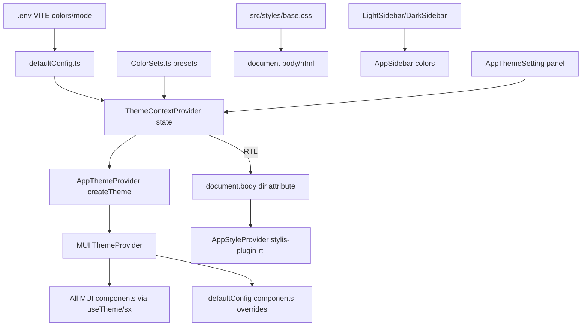

# ZeroFat Frontend — Comprehensive Architecture & UI Analysis Report

**Project:** `zero-fat-project` v4.1.1 | **Stack:** React 18, TypeScript, Vite 5, MUI v5, Crema admin template, Redux Toolkit + RTK Query

## Supplementary documents

| Document | Description |
|----------|-------------|
| [README.md](./README.md) | Documentation index |
| [ARCHITECTURE_REVIEW.md](./ARCHITECTURE_REVIEW.md) | Validated architecture findings with corrections |
| [CHANGE_SAFETY_MAP.md](./CHANGE_SAFETY_MAP.md) | Tiered file risk map for safe modifications |
| [AUTH_STRATEGY_DECISION.md](./AUTH_STRATEGY_DECISION.md) | JWT vs Redux auth unification decision |

---

## 1. Project Architecture

### Overall structure

```
zerofat-frontend-repo-dev-new-theme/
├── index.html              # HTML shell, loads /src/main.tsx
├── vite.config.ts          # Vite + aliases (@crema, src)
├── .env                    # Theme/layout/env config
├── public/                 # Static assets
└── src/
    ├── main.tsx            # React bootstrap
    ├── App.tsx             # Root provider tree
    ├── @crema/             # Crema template (layout, theme, auth, helpers)
    ├── pages/              # Feature pages (primary CRUD layer, ~50 modules)
    ├── Components/         # Shared UI + domain modals/forms
    ├── modules/            # Auth pages, error pages, account (Crema)
    ├── app/                # Legacy route modules (login, plans)
    ├── redux-config/       # Store, RTK Query API factory
    ├── config/             # Axios, settings
    ├── shared/             # Endpoints, privileges, style tokens
    ├── types/              # TypeScript DTOs per module
    ├── hooks/              # Typed Redux hooks, pagination
    ├── validation/         # Yup schemas
    └── styles/             # Global CSS
```

**Evidence:** Top-level layout from directory listing; `package.json` scripts use Vite (`dev`, `build`); [`vite.config.ts`](vite.config.ts) defines `@crema` and `src` aliases.

### Main entry points and application flow

```mermaid
flowchart TD
  html[index.html] --> main[main.tsx]
  main --> app[App.tsx]
  app --> redux[Redux Provider + PersistGate]
  redux --> ctx[AppContextProvider]
  ctx --> theme[AppThemeProvider]
  theme --> style[AppStyleProvider]
  style --> locale[AppLocaleProvider]
  locale --> router[BrowserRouter]
  router --> auth[JWTAuthProvider via AppAuthProvider]
  auth --> authGate[AuthRoutes loader gate]
  authGate --> layout[AppLayout useRoutes]
  layout -->|authenticated| shell[DefaultLayout sidebar+header]
  layout -->|unauthenticated| content[AppContentView only]
```

**Entry files:**

| File                                                                                                                     | Role                                                             |
| ------------------------------------------------------------------------------------------------------------------------ | ---------------------------------------------------------------- |
| [`index.html`](index.html)     | `#root` div; script `src="/src/main.tsx"`                        |
| [`src/main.tsx`](src\main.tsx) | `createRoot` → `<App />` in `StrictMode`; imports `rc-image` CSS |
| [`src/App.tsx`](src\App.tsx)   | Full provider tree, global CSS, layout, toasts                   |

Provider nesting in `App.tsx` (lines 23–46):

```src\App.tsx
      <Provider store={store}>
        <PersistGate loading={<>loading...</>} persistor={persister}>
          <AppContextProvider>
            <AppThemeProvider>
              <AppStyleProvider>
                <AppLocaleProvider>
                  <BrowserRouter>
                    <InfoViewContextProvider>
                      <AppAuthProvider>
                        <AuthRoutes>
                          <CssBaseline />
                          <AppLayout />
                          <AppInfoView />
                          <Toasts />
```

**Default landing:** `.env` sets `VITE__INITIAL_URL=/workout/catalog/bodyParts`. Unauthenticated users hitting `/` are redirected there, then to `/signin` because the route is authorized-only.

### Routing

- **Library:** `react-router-dom` v6 with `BrowserRouter` + `useRoutes` (not `createBrowserRouter`)
- **Route assembly:** [`src/@crema/helpers/RouteGenerator.tsx`](src@crema\helpers\RouteGenerator.tsx) merges three route tiers: anonymous → authorized → public
- **Route definitions:** [`src/@crema/core/AppRoutes/`](src@crema\core\AppRoutes) — module files per domain (Workout, NutriPlan, Clients, Core, Users, Dashboard, Auth, Errors)
- **Layout wiring:** [`src/@crema/core/AppLayout/index.tsx`](src@crema\core\AppLayout\index.tsx) calls `generateRoutes()` then `useRoutes()`; authenticated users get `Layouts[navStyle]` (11 layout variants)

Authorized route structure ([`AppRoutes/index.tsx`](src@crema\core\AppRoutes\index.tsx) lines 15–27):

```src@crema\core\AppRoutes\index.tsx
const authorizedStructure = (loginUrl: string) => {
  return {
    fallbackPath: loginUrl,
    unAuthorizedComponent: <Error403 />,
    routes: [
      ...workoutModulePages,
      ...nutriPlanModulePages,
      ...coreModuleRoutes,
      ...clientsModuleRoutes,
      ...UsersModuleRoutes,
      ...DashboardRoutes,
    ],
  };
};
```

**Lazy loading:** Partial — only Signin, Dashboard, error pages, and 2 workout pages use `React.lazy`. Most module pages are eagerly imported.

**Sidebar navigation:** [`routeconfig.tsx`](src@crema\core\AppRoutes\routeconfig.tsx) is separate from route element definitions.

**Gap found:** `AccountRoutes.tsx` exists but is not imported into `authorizedStructure`.

### State management

- **Redux Toolkit** store at [`src/redux-config/store.ts`](src\redux-config\store.ts)
- **Reducers:** Single RTK Query `api` reducer + `auth` slice ([`root.ts`](src\redux-config\root.ts))
- **Persistence:** `redux-persist` whitelists only `auth` to `localStorage`
- **No feature slices** beyond `auth` — all server state lives in RTK Query cache

### API calls

**Pattern:** One shared RTK Query API instance, extended per feature via `api.injectEndpoints()`.

Factory in [`feature-api-generator.ts`](src\redux-config\feature-api-generator.ts):

```src\redux-config\feature-api-generator.ts
export const featureApiGenerator = ({ name, tagTypes = [] }: propsType) => {
  const api = createApi({
    reducerPath: name,
    baseQuery: axiosBaseQuery({
      baseUrl: baseUrl,
    }),
    keepUnusedDataFor: settings.staleDataBeforeReFetching,
    tagTypes: tagTypes,
    endpoints: () => ({}),
  });
  return api;
};
```

- **HTTP client:** `authAxios` from [`src/config/axios/index.ts`](src\config\axios\index.ts) — requests go to `baseUrl + '/api' + endpoint`
- **Base URL:** [`src/env/base-url.ts`](src\env\base-url.ts) → `https://api-app.zerofat.ai`
- **Endpoint registry:** [`src/shared/end-points/index.ts`](src\shared\end-points\index.ts)
- **~50 feature API files** under `src/pages/*/services/api/`
- **Global error toasts:** `authAxios` 401 interceptor reloads page; other errors call `showErrorToasts` (used in 31+ API service files)

**Legacy second stack:** `jwtAxios` in [`src/@crema/services/auth/jwt-auth/`](src@crema\services\auth\jwt-auth) used by JWT login and Crema `APIHooks`.

### Authentication

**Active path:** Crema JWT context, not Redux auth slice.

| Concern        | Implementation                           | File                                                    |
| -------------- | ---------------------------------------- | ------------------------------------------------------- |
| Login UI       | `/signin` → `SigninJwtAuth`              | `src/modules/auth/Signin/`                              |
| Auth provider  | `JWTAuthProvider`                        | `src/@crema/services/auth/jwt-auth/JWTAuthProvider.tsx` |
| Token storage  | `localStorage.getItem('token')`          | JWTAuthProvider lines 58–78                             |
| Route guard    | `isAuthenticated` from `useAuthUser()`   | `AppLayout/index.tsx` lines 20, 45–49                   |
| API token sync | `setAuthToken()` + `setToken()` on login | JWTAuthProvider lines 70–71, 88–90                      |

Login flow in `JWTAuthProvider` (lines 84–98):

```src@crema\services\auth\jwt-auth\JWTAuthProvider.tsx
  const signInUser = async ({ email, password }: { email: string; password: string }) => {
    infoViewActionsContext.fetchStart();
    try {
      const { data } = await jwtAxios.post('/api/users-module/Authentication/login', { email, password });
      localStorage.setItem('token', data.token);
      setAuthToken(data.token);
      setToken(data.data.token);
      setJWTAuthData({
        user: { ...firebaseData, displayName: 'Admin' },
        isAuthenticated: true,
        isLoading: false,
      });
```

**Dual auth systems (not unified):**

- Active: JWT context + `jwtAxios` at `/signin`
- Orphan: `src/app/login/` uses RTK `useLoginMutation` + Redux `setLoginData` — not wired in routes

**Privilege checks:** [`authorized-check-wrapper`](src\Components\authorized-check-wrapper\index.tsx) — all privilege logic is commented out; `canEdit`/`canDelete` hardcoded to `true` (lines 28–29).

### Standard page pattern

Each list page follows a repeatable structure. Example: [`workoutBodyParts/index.tsx`](src\pages\workout-module\workoutBodyParts\index.tsx):

- `usePaginateData` + RTK Query hook for data
- `useXxx` custom hook for columns, modals, selection
- Compose: `AppBreadcrumb` → `Card` → `AppFilters` → `AppDataGrid`
- Domain modals imported from `src/Components/{module}/`

---

## 2. UI Framework & Theme Analysis

### UI framework

**Primary: Material UI (MUI) v5** with Emotion (`@emotion/react`, `@emotion/styled`).

From [`package.json`](package.json) lines 23–34: `@mui/material`, `@mui/icons-material`, `@mui/lab`, `@mui/x-data-grid`, `@mui/x-date-pickers`.

**Not present:** Tailwind, Bootstrap, Ant Design, Chakra UI.

**Secondary libraries:** `notistack`, `react-icons`, `apexcharts`, `rc-image`, `simplebar-react`, `slick-carousel`, TipTap, Google Maps.

**Template:** Crema React Admin — entire `src/@crema/` directory provides layout, theme, auth scaffolding.

### Global theme configuration

**Yes — globally configured** through a multi-layer provider chain.

| Layer          | File                                                                                                                                                                                  | Purpose                                                  |
| -------------- | ------------------------------------------------------------------------------------------------------------------------------------------------------------------------------------- | -------------------------------------------------------- |
| Default tokens | [`defaultConfig.ts`](src@crema\constants\defaultConfig.ts)                                  | Palette, typography, component overrides, sidebar colors |
| Color presets  | [`ColorSets.ts`](src@crema\constants\ColorSets.ts)                                          | Light/Dark preset palettes for customizer                |
| Enums          | [`AppEnums.ts`](src@crema\constants\AppEnums.ts)                                            | `ThemeMode`, `NavStyle`, `LayoutType`, etc.              |
| React state    | [`ThemeContextProvider.tsx`](src@crema\context\AppContextProvider\ThemeContextProvider.tsx) | Runtime theme mode/style state                           |
| MUI theme      | [`AppThemeProvider/index.tsx`](src@crema\context\AppThemeProvider\index.tsx)                | `createTheme()` + `ThemeProvider`                        |
| RTL cache      | [`AppStyleProvider/index.tsx`](src@crema\context\AppStyleProvider\index.tsx)                | Emotion `CacheProvider` + `stylis-plugin-rtl`            |
| Customizer UI  | [`AppThemeSetting/`](src@crema\components\AppThemeSetting)                                  | In-app theme panel                                       |

### Colors, typography, spacing, breakpoints

**Colors** — default palette in `defaultConfig.ts` (lines 45–66):

```src@crema\constants\defaultConfig.ts
    palette: {
      mode: ThemeMode.LIGHT,
      background: {
        paper: "#FFFFFF",
        default: "#F4F7FE",
      },
      primary: {
        main: "#a5d060",
        contrastText: "#fff",
      },
      secondary: {
        main: "#F04F47",
      },
```

`.env` mirrors brand colors: `VITE__PRIMARY_COLOR='#a5d060'`, `VITE__SECONDARY_COLOR='#F04F47'`.

**Typography:** `fontFamily: ["Be Vietnam", "system-ui"]`, `fontSize: 14`, heading scales h1–h6 in `defaultConfig.ts` (lines 82+).

**Spacing:** MUI spacing unit = `4` (line 42) → `theme.spacing(1)` = 4px. Additional JS tokens in [`shared/styles/index.ts`](src\shared\styles\index.ts) (`borderRadius.sharp/normal/medium/large`).

**Border radius:** `cardRadius: ThemeStyleRadius.STANDARD` (16px) via `AppEnums.ts`.

**Breakpoints:** MUI defaults (xs/sm/md/lg/xl) — no custom overrides found. Helper `useWidth()` in `@crema/helpers/Common.tsx`.

**Component overrides:** MUI `components` key in `defaultConfig.ts` overrides `MuiCard`, `MuiButton`, `MuiOutlinedInput`, `MuiSelect`, `MuiIconButton`, `MuiLink` (lines 129–196).

**Sidebar tokens:** `LightSidebar` / `DarkSidebar` objects (lines 209–224); default uses `LightSidebar` with `sidebarMenuSelectedBgColor: "#a5d060"`.

### Light/dark themes

**Supported at runtime** via `AppThemeSetting` customizer and `ThemeContextProvider`:

```src@crema\context\AppContextProvider\ThemeContextProvider.tsx
  useEffect(() => {
    theme.palette = {
      ...theme.palette,
      mode: themeMode === ThemeMode.DARK ? ThemeMode.DARK : ThemeMode.LIGHT,
      background:
        themeMode === ThemeMode.DARK ? backgroundDark : backgroundLight,
      text: themeMode === ThemeMode.DARK ? textDark : textLight,
    };
    updateTheme(theme);
  }, [themeMode, theme, updateTheme]);
```

- **Default:** `ThemeMode.LIGHT` in `defaultConfig.ts` line 234 and `.env` `VITE__THEME_MODE=light`
- **Not persisted:** Theme mode lives in React state only; page refresh resets to light
- **No `prefers-color-scheme`** detection found
- **Multiple color presets:** `ColorSets.ts` provides many light/dark palette variants selectable in customizer

---

## 3. Reusable Components Analysis

### Three UI layers

```mermaid
flowchart LR
  subgraph pages [src/pages]
    listPages[List CRUD pages]
  end
  subgraph base [src/Components/baseComponents]
    grid[AppDataGrid]
    filters[AppFilters]
    modals[Modals]
  end
  subgraph crema [src/@crema/components]
    layout[AppLayout]
    loader[AppLoader]
  end
  subgraph domain [src/Components modules]
    workoutModals[workout modals]
    nutriModals[nutriplan modals]
  end
  listPages --> base
  listPages --> domain
  crema --> listPages
```

### Layer 1: `src/Components/baseComponents/` (primary shared kit)

| Component                        | Path                               | Purpose                                    | Wraps                             | Importing files                 |
| -------------------------------- | ---------------------------------- | ------------------------------------------ | --------------------------------- | ------------------------------- |
| **AppDataGrid**                  | `dataGrid/AppDataGrid.tsx`         | Paginated/sortable data tables             | `@mui/x-data-grid` DataGrid       | **44** list pages               |
| **AppFilters**                   | `filters/AppFilters.tsx`           | Search, add, bulk delete/activate, refresh | MUI TextField, Button, Menu       | **44** list pages               |
| **AppBreadcrumb**                | `breadcrumb/AppBreadcrumb.tsx`     | Page title + breadcrumb trail              | MUI Typography/Breadcrumbs        | **43** files                    |
| **AppConfirmModal**              | `modals/AppConfirmModal.tsx`       | Delete/confirm dialogs                     | MUI Dialog                        | **34** `useXxx` hooks           |
| **AppAddModal / Edit / Details** | `modals/`                          | CRUD dialog shells                         | MUI Dialog + Stepper              | **~55** domain forms            |
| **StatusBadge family**           | `badge/` (24 badges)               | Domain status chips                        | MUI Chip                          | Column renderers across modules |
| **AppButton**                    | `buttons/AppButton.tsx`            | Action button with loading                 | MUI Button                        | **16** files                    |
| **Input family**                 | `inputs/` (12+ components)         | Checkbox, switch, editor, date pickers     | MUI + TipTap + MUI X Date Pickers | **~65** import lines            |
| **AppProfile**                   | `profile/AppProfile.tsx`           | Entity profile layout                      | MUI + tabs                        | Profile pages                   |
| **LoadingAndErrorWrapper**       | `other/LoadingAndErrorWrapper.tsx` | Loading/error states                       | MUI Box                           | Modals, profiles                |
| **AppGoogleMap**                 | `googleMap/AppGoogleMap.tsx`       | Map picker                                 | `@react-google-maps/api`          | Client locations                |

`AppDataGrid` wraps MUI X DataGrid (lines 3–18 of `AppDataGrid.tsx`):

```src\Components\baseComponents\dataGrid\AppDataGrid.tsx
import {
  DataGrid,
  GridCallbackDetails,
  GridColDef,
  ...
} from "@mui/x-data-grid";
```

### Layer 2: Generic `src/Components/` (legacy + utilities)

| Component                       | Path                            | Purpose                                                 | Usage                               |
| ------------------------------- | ------------------------------- | ------------------------------------------------------- | ----------------------------------- |
| **formik-input / DynamicInput** | `formik-input/`                 | Formik-connected inputs (text, select, date, file)      | **~15** files                       |
| **generate-form-component**     | `generate-form-component/`      | Schema-driven Formik form builder                       | **6** consumers (legacy `src/app/`) |
| **toasts**                      | `toasts.tsx`                    | Global snackbar + `showErrorToasts`/`showSuccessToasts` | **31+** API files + `App.tsx`       |
| **generic-table / main-table**  | `generic-table/`, `main-table/` | Legacy MUI table stack                                  | **2** files in `src/app/`           |
| **dialog**                      | `dialog/` (7 dialogs)           | Delete, confirm, image preview dialogs                  | Internal + legacy tables            |
| **cards/Main-card**             | `cards/Main-card.tsx`           | Styled card container                                   | **3** files                         |
| **authorized-check-wrapper**    | `authorized-check-wrapper/`     | Privilege HOC (disabled)                                | **4** `src/app/` files              |
| **dashboard widgets**           | `dashboard/`                    | Stats cards, ApexCharts widgets                         | Dashboard page only                 |

**Likely unused (0 external imports found):** `selectFilter`, `suspenseWrapper`, `price-format`, `date-formated-cell`, `date-filter`, `excel-file-input`.

### Layer 3: `src/@crema/components/` (Crema template)

Used primarily for layout shell, auth pages, error pages, loaders. Key components:

- `AppLayout` (11 layout variants), `AppContentView`, `AppSidebar`, `AppHeader`, `AppFooter`
- `AuthRoutes`, `AppLoader`, `AppSuspense`, `AppErrorBoundary`
- `AppFormComponents/` (TextField, Select wrappers)
- `AppThemeSetting/` (theme customizer panel)
- `AppScrollbar`, `AppSearchBar`, `AppSelect`

~36 files outside `@crema/` import from `@crema/components` (auth modules, error pages, dashboard charts, `App.tsx`).

### Domain-specific reusable components

Under `src/Components/` — feature CRUD modals/forms consumed by `src/pages/`:

| Folder              | Files | Domain                               |
| ------------------- | ----- | ------------------------------------ |
| `wrokout-module/`   | ~90   | Workouts, trainers, plans, equipment |
| `nutriplan-module/` | ~80   | Meals, recipes, ingredients, menus   |
| `clients-module/`   | ~25   | Clients, subscriptions, selections   |
| `core-module/`      | ~15   | FAQs, banners, ads                   |
| `users-module/`     | ~5    | Admin management                     |
| `dashboard/`        | 10    | Dashboard widgets                    |

These are **domain-reusable** (shared within a module) but not generic primitives.

### Heavily reused components (ranked by impact)

1. **AppDataGrid** — every list page (~44 screens)
2. **AppFilters** — every list page (~44 screens)
3. **AppBreadcrumb** — most list/profile pages (~43 screens)
4. **AppConfirmModal** — every `useXxx` hook with delete (~34 screens)
5. **showErrorToasts** — all API error handling (~31 services)
6. **Domain badges** — all column definition files
7. **Modal family** (Add/Edit/Details) — all CRUD flows

---

## 4. Styling Strategy

### Approaches in use

| Method                       | Evidence                                             | Scope                     |
| ---------------------------- | ---------------------------------------------------- | ------------------------- |
| **MUI `sx` prop**            | Hundreds of usages in `src/pages/` and `Components/` | Per-component             |
| **MUI `styled()`** (Emotion) | `index.style.tsx` files in `@crema/components/`      | Component-scoped          |
| **Emotion**                  | `@emotion/react`, `AppStyleProvider` RTL cache       | Global engine             |
| **Plain CSS**                | `src/styles/*.css`                                   | Global                    |
| **JS style objects**         | `src/shared/styles/index.ts`                         | Shared tokens             |
| **clsx**                     | Dependency in package.json                           | Class merging             |
| **MUI theme overrides**      | `defaultConfig.ts` `components` key                  | Global component defaults |

**Not used:** SCSS, CSS Modules, Tailwind, styled-components.

### Style organization

```
Global CSS chain:
  App.tsx imports styles/index.css
    → base.css (reset, typography, CSS variables)
    → maps.css (embed-responsive)
    → wysiwyg.css (editor lists)

MUI baseline:
  CssBaseline in App.tsx

Third-party CSS:
  main.tsx → rc-image/assets/index.css
  AppScrollbar → simplebar-react CSS
  AppMediaViewer → slick-carousel CSS
```

Global CSS variables in [`base.css`](src\styles\base.css) (lines 1–8):

```src\styles\base.css
:root {
  --light: 300;
  --regular: 400;
  --medium: 500;
  --bold: 600;
  --extra-bold: 700;
  font-family: system-ui;
  height: 100%;
}
```

RTL override in [`styles/index.css`](src\styles\index.css) (lines 5–7) and `base.css` (lines 19–21).

### Global styles affecting multiple screens

| File                                          | Global impact                                           |
| --------------------------------------------- | ------------------------------------------------------- |
| `defaultConfig.ts` MUI `components` overrides | All MuiButton, MuiCard, MuiOutlinedInput, etc.          |
| `CssBaseline`                                 | Box model, typography baseline                          |
| `base.css`                                    | `*` reset, `body`/`html`/`#root` sizing, heading styles |
| `ThemeContextProvider`                        | `document.body dir` attribute for RTL                   |
| `authAxios` interceptor                       | Global error toasts on any API failure                  |
| `Toasts` component in `App.tsx`               | Global snackbar rendering                               |

---

## 5. UI Modification Risk Assessment

### Logic changes without visual changes — possible side effects

| Change area                              | Side effect risk      | Why                                                                                                                      |
| ---------------------------------------- | --------------------- | ------------------------------------------------------------------------------------------------------------------------ |
| `useXxx` hooks (pagination, modal state) | **Medium**            | Shared pattern across 40+ pages; hook bugs affect one module but pattern is copy-pasted                                  |
| RTK Query `services/api/index.ts`        | **High (functional)** | Changes cache tags, error handling, or response transforms affect page data — toasts fire globally via axios interceptor |
| `feature-api-generator.ts`               | **Critical**          | Single API factory — changes affect every endpoint                                                                       |
| `config/axios/index.ts`                  | **Critical**          | 401 reload, global error toasts                                                                                          |
| `JWTAuthProvider`                        | **Critical**          | Login/logout, token sync, route access                                                                                   |
| `RouteGenerator.tsx`                     | **Critical**          | All route access control                                                                                                 |
| `AppDataGrid` props/behavior             | **High (visual)**     | Used on 44 pages — pagination, sorting, toolbar changes propagate everywhere                                             |
| `AppFilters` props/behavior              | **High (visual)**     | Bulk actions, search UI on 44 pages                                                                                      |
| `defaultConfig.ts` palette/overrides     | **High (visual)**     | App-wide color and component styling                                                                                     |
| Domain modals in `Components/{module}/`  | **Low–Medium**        | Scoped to one feature; safe for logic, but form validation changes can break submit flows                                |
| `authorized-check-wrapper`               | **Low (currently)**   | Privilege checks disabled — enabling them would block pages                                                              |
| Page `*Columns.tsx` files                | **Low**               | Scoped to one table's cell renderers                                                                                     |
| `usePaginateData` hook                   | **High**              | Shared by all list pages                                                                                                 |

### Safe to modify (minimal UI risk)

- `src/pages/{module}/services/api/index.ts` — endpoint URLs, tag types (if response shape unchanged)
- `src/pages/{module}/useXxx.tsx` — modal open/close logic, column action handlers (if JSX unchanged)
- `src/types/` — TypeScript types only
- `src/shared/end-points/` — URL path builders
- `src/validation/` — Yup schemas (may affect form error messages)
- Individual `*Columns.tsx` — cell renderer logic for one entity
- `src/hooks/use-paginate-data.ts` — if return interface preserved

### Requires caution (multi-page impact)

| File/Component                                                      | Pages affected                      |
| ------------------------------------------------------------------- | ----------------------------------- |
| `AppDataGrid.tsx`                                                   | ~44 list pages                      |
| `AppFilters.tsx`                                                    | ~44 list pages                      |
| `AppBreadcrumb.tsx`                                                 | ~43 pages                           |
| `AppConfirmModal.tsx`                                               | ~34 delete flows                    |
| `modals/AppAddModal.tsx`, `AppEditModal.tsx`, `AppDetailsModal.tsx` | All CRUD modals                     |
| `defaultConfig.ts`                                                  | Entire app appearance               |
| `ThemeContextProvider.tsx`                                          | Entire app theme                    |
| `AppLayout/` (any variant)                                          | All authenticated screens           |
| `routeconfig.tsx`                                                   | Sidebar navigation globally         |
| `toasts.tsx`                                                        | All API error/success notifications |
| `badge/*` components                                                | All tables using that badge type    |

### Tightly coupled code (regression risk)

1. **Dual auth stacks** — JWT context vs Redux `auth` slice; `setToken(data.data.token)` in login (line 90) suggests inconsistent response shape (`data.token` vs `data.data.token`)
2. **Dual axios instances** — `authAxios` (RTK Query) vs `jwtAxios` (login); token must be set on both
3. **Commented Redux token interceptor** — `authAxios` does not read token from Redux store (lines 64–67 of `config/axios/index.ts`)
4. **Page triad pattern** — `index.tsx` + `useXxx.tsx` + `XxxColumns.tsx` + `Components/{module}/` modals — changing one file's interface breaks the chain
5. **i18n keys** — `messages["sidebar.xxx"]` in breadcrumbs/filters; renaming keys breaks labels without visual structure change

---

## 6. Theme & Design Dependency Mapping

### Theme flow



### Single-location changes with app-wide impact

| Change location                             | What it affects                                                |
| ------------------------------------------- | -------------------------------------------------------------- |
| `defaultConfig.ts` → `palette.primary.main` | All `color="primary"` buttons, links, chips, sidebar selection |
| `defaultConfig.ts` → `typography`           | All MUI Typography variants                                    |
| `defaultConfig.ts` → `spacing: 4`           | All `theme.spacing()` calculations                             |
| `defaultConfig.ts` → `components.MuiButton` | Every Button in the app                                        |
| `ThemeContextProvider` mode toggle          | Background, text colors app-wide                               |
| `LightSidebar`/`DarkSidebar`                | Sidebar background, menu selection colors                      |
| `AppThemeProvider`                          | Re-creates entire MUI theme object on any context change       |
| `.env` `VITE__NAV_STYLE` / `VITE__LAYOUT`   | Layout shell variant                                           |

### Context providers (global configuration)

| Provider                  | File                                  | State managed                                    |
| ------------------------- | ------------------------------------- | ------------------------------------------------ |
| Redux `Provider`          | `App.tsx`                             | RTK Query cache, auth slice                      |
| `PersistGate`             | `App.tsx`                             | Rehydration gate                                 |
| `AppContextProvider`      | `@crema/context/AppContextProvider/`  | Composes theme, layout, locale, sidebar contexts |
| `ThemeContextProvider`    | Theme mode, style, palette object     |
| `LayoutContextProvider`   | Nav style, layout type, header/footer |
| `LocaleContextProvider`   | Language selection                    |
| `SidebarContextProvider`  | Sidebar colors, menu style            |
| `AppThemeProvider`        | MUI ThemeProvider                     |
| `AppStyleProvider`        | Emotion RTL cache                     |
| `AppLocaleProvider`       | react-intl                            |
| `InfoViewContextProvider` | Loading overlay state                 |
| `JWTAuthProvider`         | Auth state                            |
| `BrowserRouter`           | Routing                               |

---

## 7. Refactoring Safety Report

### Safe to refactor (minimal UI risk)

| Target                                                      | Rationale                                     |
| ----------------------------------------------------------- | --------------------------------------------- |
| `src/types/**`                                              | Type-only changes                             |
| `src/shared/end-points/**`                                  | URL builders, no UI                           |
| `src/pages/*/services/api/**`                               | Isolated per module; preserve hook exports    |
| `src/validation/**`                                         | Schema logic; may change error text only      |
| Individual `useXxx.tsx` hooks                               | Scoped state logic if component JSX unchanged |
| `src/env/base-url.ts`                                       | API URL only                                  |
| Orphan components (`selectFilter`, `suspenseWrapper`, etc.) | No external consumers                         |
| `src/utilities/**`                                          | Pure functions                                |

### High-impact — changes likely affect multiple pages

| Target                                   | Blast radius              |
| ---------------------------------------- | ------------------------- |
| `src/Components/baseComponents/**`       | 40–44 pages per component |
| `src/@crema/constants/defaultConfig.ts`  | Entire visual identity    |
| `src/@crema/core/AppLayout/**`           | All authenticated layouts |
| `src/@crema/core/AppRoutes/**`           | All routing               |
| `src/@crema/helpers/RouteGenerator.tsx`  | All route guards          |
| `src/redux-config/**`                    | All API calls             |
| `src/config/axios/**`                    | All HTTP + global toasts  |
| `src/Components/toasts.tsx`              | All notifications         |
| `src/@crema/services/auth/**`            | Login/logout/session      |
| `src/Components/baseComponents/badge/**` | All tables using badges   |

### Breaking points

1. Changing `AppDataGrid` prop interface — breaks 44 page files
2. Changing `AppFilters` prop interface — breaks 44 page files
3. Changing RTK Query response transform in `feature-api-generator` — breaks all endpoints
4. Enabling `authorized-check-wrapper` privilege checks — may block pages users currently access
5. Modifying `defaultConfig.ts` `components` overrides — subtle visual regressions across all forms/buttons
6. Renaming i18n message keys — broken labels across breadcrumbs/filters
7. Switching auth from JWT context to Redux-only — breaks route guards and token sync

---

## 8. Development Recommendations

### Best practices for preserving UI while changing code

1. **Follow the page triad pattern** — keep changes inside `useXxx.tsx` (logic) and `services/api/` (data); avoid touching `index.tsx` JSX unless necessary
2. **Never modify `baseComponents` for a single-page fix** — override via props or page-local styling instead
3. **Test list pages after any `AppDataGrid`/`AppFilters` change** — spot-check workout, nutriplan, and clients modules
4. **Keep theme changes in `defaultConfig.ts`** — avoid hardcoding colors in page `sx` props; use `theme.palette.primary.main`
5. **When changing API logic**, preserve RTK Query hook signatures (`useGetAllXxxQuery`, `useDeleteXxxMutation`) so pages don't break
6. **Auth changes:** always update both `setAuthToken` and `setToken` — dual axios stacks require both
7. **Use browser DevTools** to verify changes don't leak via global CSS (`base.css`) or MUI overrides

### Improvement areas (no UI/functionality impact if done carefully)

| Area                        | Recommendation                                                                    | Files                                           |
| --------------------------- | --------------------------------------------------------------------------------- | ----------------------------------------------- |
| Dead code cleanup           | Remove unused components (`selectFilter`, `suspenseWrapper`, etc.)                | `src/Components/`                               |
| Auth unification            | Consolidate JWT context + Redux auth into one source of truth                     | `JWTAuthProvider`, `auth` slice, `config/axios` |
| Fix login token bug         | `setToken(data.data.token)` vs `data.token` inconsistency                         | `JWTAuthProvider.tsx` line 90                   |
| Enable privilege checks     | Uncomment `authorized-check-wrapper` when backend privileges ready                | `authorized-check-wrapper/index.tsx`            |
| Theme persistence           | Save `themeMode` to localStorage in `ThemeContextProvider`                        | `ThemeContextProvider.tsx`                      |
| Code splitting              | Add `React.lazy` to remaining module routes                                       | `AppRoutes/*.tsx`                               |
| Wire orphan routes          | Connect `AccountRoutes` or remove; unify `src/app/login` with `/signin`           | `AppRoutes/index.tsx`                           |
| Re-enable axios interceptor | Auto-attach Redux token on requests                                               | `config/axios/index.ts` lines 64–67             |
| Consolidate UI stacks       | Migrate legacy `main-table`/`generate-form-component` to `baseComponents` pattern | `src/app/`, `src/Components/`                   |

---

## Summary

For validated corrections, risk-tier file lists, and the auth unification decision, see [ARCHITECTURE_REVIEW.md](./ARCHITECTURE_REVIEW.md), [CHANGE_SAFETY_MAP.md](./CHANGE_SAFETY_MAP.md), and [AUTH_STRATEGY_DECISION.md](./AUTH_STRATEGY_DECISION.md).

This is a **Crema-based MUI v5 admin dashboard** for ZeroFat with a well-established **page pattern** (Breadcrumb → Filters → DataGrid → Modals). The highest-risk files for unintended UI changes are in `src/Components/baseComponents/` and `src/@crema/constants/defaultConfig.ts`. Logic-only changes are safest when confined to per-module `useXxx.tsx` hooks, `services/api/`, and `types/`. Global theme, layout, routing, and axios configuration changes propagate across the entire application.

